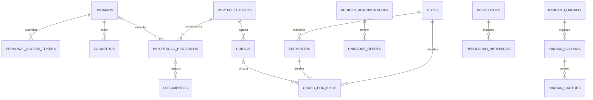

# Banco de dados

## Fonte e ambiente

O esquema é definido pelas migrations em `Back_SIPED/database/migrations`; os models em `Back_SIPED/app/Models` definem casts e relações de aplicação. O README local configura MySQL. `config/database.php` tem fallback SQLite, e os testes usam SQLite em memória. O motor efetivamente usado por homologação/produção não foi verificado.

As migrations históricas alteram tabelas criadas anteriormente. Para conhecer tipos, nulabilidade, defaults, índices e restrições de uma instalação, considerar a sequência completa de migrations, não apenas a migration inicial.

## Inventário de tabelas

| Grupo | Tabelas principais | Finalidade observável |
|---|---|---|
| Acesso e auditoria | `usuarios`, `personal_access_tokens`, `cadastros` | Contas SIPED, tokens Sanctum e eventos de auditoria/autoria. |
| Portfólio | `cursos`, `plano_de_metas`, `pcas`, `curso_por_eixos`, `portfolio_ciclos`, `eixos`, `segmentos` | Catálogo de cursos, planejamento, PCA, ofertas/acompanhamentos e classificação oficial por ciclo. |
| Processos | `visita_tecnicas`, `hora_pedagogicas`, `acao_extensivas`, `eventos`, `jornadas_pedagogicas` | Registros operacionais e fluxos pedagógicos. |
| Estruturas e pessoas | `cped_equipes`, `regioes_administrativas`, `unidades_oferta` | Equipe, regiões administrativas e unidades de oferta. |
| Gestão e ferramentas | `kanban_quadros`, `kanban_colunas`, `kanban_cartoes`, `fluxogramas`, `notificacao_leituras` | Quadros e cartões, fluxogramas e leituras de notificações. |
| Documentos e histórico | `documentos`, `importacao_historicos`, `sincronizacao_historicos` | Metadados de arquivos, importações e sincronizações externas. |
| Resoluções e termos | `resolucoes`, `resolucao_historicos`, `termos_referencia`, `termos_referencia_historicos` | Registros e histórico de alterações dessas entidades. |
| Suporte Laravel | `users`, `password_reset_tokens`, `sessions`, `cache`, `cache_locks`, `jobs`, `job_batches`, `failed_jobs` | Tabelas de infraestrutura do framework; sua utilização depende da configuração de sessão/cache/fila. |

As migrations também podem conter tabelas temporárias de backfill. Elas não devem ser tratadas como entidades de negócio sem verificar a migration correspondente.

## Relações principais

O diagrama resume relações com chaves estrangeiras evidenciadas nas migrations; associações polimórficas ou sem FK física podem existir na camada de models e não estão representadas como constraints.

## Colunas e restrições relevantes

- As tabelas de negócio usam chave primária `id` e timestamps Laravel quando declarados. As migrations adicionam `deleted_at` a tabelas de negócio para exclusão lógica.
- `cursos` contém `titulo` obrigatório, status com default `ATIVO`, ciclo opcional e campos de catálogo (eixo, modalidade, códigos, datas, unidade e informações de planejamento). `unidades_oferta` é JSON; detalhes permanecem na migration e no model.
- `eixos.nome` e `segmentos.nome` armazenam classificações; ambas têm `slug` único. `segmentos.eixo_id` referencia `eixos` com exclusão em cascata.
- `portfolio_ciclos.origem_id` referencia outro ciclo e usa `nullOnDelete`; a tabela também guarda `atual` e metadados de autoria.
- `curso_por_eixos` ganhou FKs opcionais para eixo, segmento e curso; vínculos são complementados por backfills em migrations posteriores.
- `documentos` guarda módulo e identificador do registro, nome, caminho, MIME, tamanho e hash; o arquivo é armazenado fora do conteúdo binário da linha. A relação com usuário e histórico de importação pode ser anulada na exclusão do pai.
- `importacao_historicos` guarda módulo, situação, arquivo, contagens, detalhes e ciclo/usuário associados. A tabela de auditoria `cadastros` pode conter IP e user-agent, além da ação e dados associados.

## Dados pessoais e cuidados

As migrations/modelos incluem dados de identificação e contato de usuários, incluindo CPF, e-mail, telefone e foto; auditoria pode guardar IP/user-agent e os documentos podem conter informações de processos. A finalidade observável é autenticação, gestão de usuários, autoria/auditoria, exibição institucional e vínculo de documentos. A política de retenção, base legal, classificação e prazo de eliminação devem ser confirmados com os responsáveis internos.

## Seeders

Os seeders são destinados a inicialização local/teste e podem inserir contas e registros de demonstração. Consulte `Back_SIPED/database/seeders` antes de executá-los. Não execute seed em banco compartilhado ou real sem aprovação. As credenciais de demonstração documentadas no README não são credenciais de produção.