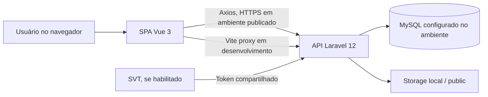

# Manual técnico

## Arquitetura

O SIPED é composto por uma API Laravel 12 em `Back_SIPED/` e uma SPA Vue 3 em `Front_SIPED/`. O Vite empacota a aplicação e grava os assets em `Back_SIPED/public/build/siped`. O front usa Axios e rotas relativas `/api`; em desenvolvimento, Vite encaminha `/api`, `/IMG` e `/storage` para `VITE_API_URL` (padrão `http://127.0.0.1:8000`). A API usa Sanctum com token Bearer para as rotas autenticadas.



O SVT é uma integração opcional configurada por variáveis de ambiente; sua disponibilidade e conexão com sistemas externos não foram verificadas neste ambiente. Detalhes de payload e configuração estão em [integracao-svt.md](integracao-svt.md).

## Requisitos e instalação

- PHP `^8.2`, Composer e extensões exigidas por Laravel e PhpSpreadsheet.
- Node.js `20.19+` ou `22.12+`, conforme instruções do README e compatibilidade do Vite.
- MySQL para a configuração local documentada. `config/database.php` usa SQLite como fallback se `DB_CONNECTION` não estiver definido; isso não substitui a configuração local do README.
- No Windows, `local-start.cmd` é o caminho documentado de instalação e execução.

Para instalar dependências manualmente, copie os arquivos `.env.example` para os respectivos `.env`, configure o banco e execute:

```cmd
cd Back_SIPED
composer install
php artisan key:generate
php artisan migrate
php artisan storage:link
php artisan db:seed

cd ..\Front_SIPED
npm install
```

Em terminais separados, inicie `php artisan serve --host=127.0.0.1 --port=8000` no backend e `npm run dev` no frontend. Em banco compartilhado, não execute migrations, seeders nem `local-start.cmd` sem aprovação e confirmação do alvo.

## Configuração

Variáveis confirmadas no código/configuração incluem:

| Variável | Uso |
|---|---|
| `APP_ENV`, `APP_DEBUG`, `APP_KEY`, `LOG_LEVEL` | Ambiente, detalhes de erro, criptografia e logging do Laravel. |
| `DB_CONNECTION`, `DB_HOST`, `DB_PORT`, `DB_DATABASE`, `DB_USERNAME`, `DB_PASSWORD` | Conexão ao banco; valores de segredo devem permanecer apenas no `.env`. |
| `VITE_API_URL` | Destino do proxy da API durante desenvolvimento Vite. |
| `VISITAS_TECNICAS_ORIGEM`, `SVT_INTEGRACAO_TOKEN`, `SVT_BASE_URL`, `SVT_VISITA_URL` | Origem e integração opcional com SVT; ver [integracao-svt.md](integracao-svt.md). |

Nunca versionar `.env`, tokens, chaves ou senhas. Para exemplos, use valores fictícios.

## Banco, migrations e seeders

As migrations em `Back_SIPED/database/migrations` são a fonte do esquema. Para aplicar migrations em uma base local recém-criada, use `php artisan migrate`; seed de desenvolvimento usa `php artisan db:seed`. `local-start.cmd` usa migrations e seeders com `--force`, portanto não o execute apontado a uma base real.

As tabelas, relações e dados sensíveis estão resumidos em [banco-dados.md](banco-dados.md). O estado efetivamente aplicado em homologação precisa ser conferido com `php artisan migrate:status` no ambiente autorizado.

## Testes e build

```cmd
cd Back_SIPED
php artisan test

cd ..\Front_SIPED
npm run build
```

Os testes PHP usam SQLite `:memory:`, cache/sessão em memória e fila síncrona, conforme `Back_SIPED/phpunit.xml`. O bootstrap do PHPUnit regenera os arquivos Excel ignorados pelo Git antes da suíte. O front-end não declara script `test` no `package.json`; os testes existentes podem ser executados com Node usando `node --test tests\*.test.mjs` no Windows.

## Arquivos e execução publicada

O link `Back_SIPED/public/storage` deve apontar para `Back_SIPED/storage/app/public`. O servidor web deve ter permissão de escrita nas pastas Laravel `storage/` e `bootstrap/cache/`, e leitura dos assets compilados. O diretório público do servidor deve ser `Back_SIPED/public`, não a raiz do repositório.

Para build, `npm run build` gera `Back_SIPED/public/build/siped`. O `vite.config.js` usa base `/build/siped/` para build. Em ambiente publicado, use `APP_DEBUG=false`, HTTPS, logs sem segredos e credenciais com privilégio mínimo. IIS/Apache/Nginx, certificados, backups, política de deploy e valores de produção precisam ser definidos e validados pela equipe responsável; não foram testados aqui.

## Diagnóstico local

- Erro ao conectar ao banco: conferir host/porta/credenciais do `.env` e se o serviço MySQL correto está ativo.
- Fotos não carregam: confirmar `php artisan storage:link` e permissões de leitura.
- API não responde: conferir `GET /up` e o processo/porta 8000.
- Falha de dependência/build: confirmar versões de PHP, Composer e Node e reinstalar dependências somente após revisar o lockfile.
- Erro de autorização: verificar perfil e regras em `config/permissoes.php`, middleware e controller; não conceder perfil amplo como tentativa de diagnóstico.